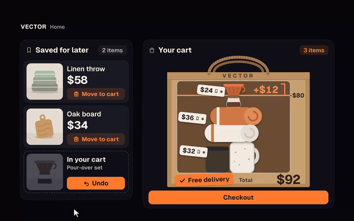

# Saved to Cart

**Move a saved item to the cart and watch it drop into a paper bag, past the free-delivery line.**



**Live demo:** [veraetogrex-portfolio.github.io/saved-to-cart](https://veraetogrex-portfolio.github.io/saved-to-cart/) · **Mockup:** [full-screen version](https://veraetogrex-portfolio.github.io/saved-to-cart/mockup/saved-to-cart.html)

A shop screen with "Saved for later" on the left and the cart drawn as a kraft paper bag with a window in it. Through the window you see what's inside, stacked up to a dashed line marked $80 — free delivery. While the cart is short, a bracket shows what's missing ("$12 to go"). Press "Move to cart" on the $24 pour-over set: it lifts out of its photo, goes behind the bag's handles and drops onto the pile. The total goes from $68 to $92, the bracket flips above the line as "+$12", the line turns solid and the bag gets an orange "✓ Free delivery" sticker. The slot the card left keeps an Undo.

## Use it

Three files, no build step, no dependencies, no web fonts:

```
index.html   markup
style.css    styles
script.js    data, layout and animation
```

Download the repo and open `index.html`, or copy the three files into your project.

## Try it

- Click "Move to cart" on any saved item. It drops into the bag, the total counts up and the bracket shows how far you are from free delivery, or how far over it.
- Click Undo in the empty slot to take it back out. It rises out of the bag and returns to its photo.
- Click a price tag on anything in the bag to save it for later, including the two things that start in the cart.
- Move everything in ($184) and everything out ($0). With more than three saved items, the extra cards pile up under the third slot; take the top one and the next one comes up.
- Keyboard: Tab to a button, Enter or Space. After a move, focus goes to Undo (or to the item's price tag when there's no free slot for Undo).
- Click Checkout: it dispatches a `cart:checkout` event with the items, the total and whether delivery is free.

```js
document.addEventListener('cart:checkout', e => console.log(e.detail));
// { items: [{ id, name, price }, …], total: 60, freeDelivery: false }
```

## Make it yours

At the top of `script.js`:

- `ITEMS`: the products, `[name, price in dollars]`.
- `START`: what starts saved and what starts in the cart (bottom of the pile first).
- `FREE_FROM`: the free-delivery threshold, `80`. The dashed line, the "$80" mark and the bracket follow it.
- `ART`: the product drawings on a 128×128 studio backdrop. In the bag the same drawing is shown without the backdrop, sized so its height matches its price.
- `PILE_X`: where each thing sits across the window. `LEFT` and `SPAN`: each drawing's left edge and its top and bottom (of 128), used to size it and to hang its price tag. Change them if you draw new products.

Colours live in `:root` in `style.css`: `--ember` for buttons and the sticker, `--ember-lit` for "+$12", the bracket and the solid line inside the bag, `--kraft` and `--kraft-in` for the bag, `--studio` for the photo backdrop.

## What's in `mockup/`

The full 1440×900 screen this component was shot in for the reel:

- `mockup/saved-to-cart.html` — interactive. `D` plays the demo, `R` resets.
- `mockup/saved-to-cart.autoplay.html` — the scripted loop the reel was recorded from.
- URL flags: `?frame` puts the screen in a browser window, `?clean` hides the control panel, `?once` plays the demo once.

The mockup loads the same `style.css` and `script.js` from the root, plus a shared stage runtime and bundled fonts from `mockup/_shared/`. The component in the root doesn't need any of it.

---

Component 27 of a series. New one every day on Instagram [@veraetogrex_portfolio](https://www.instagram.com/veraetogrex_portfolio/) · all components: [github.com/veraetogrex-portfolio](https://github.com/veraetogrex-portfolio)

MIT licensed.
